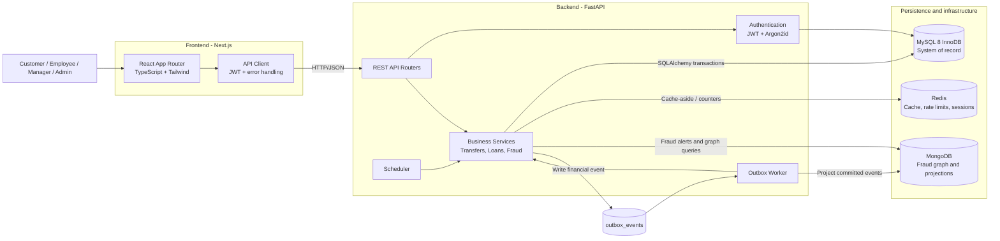
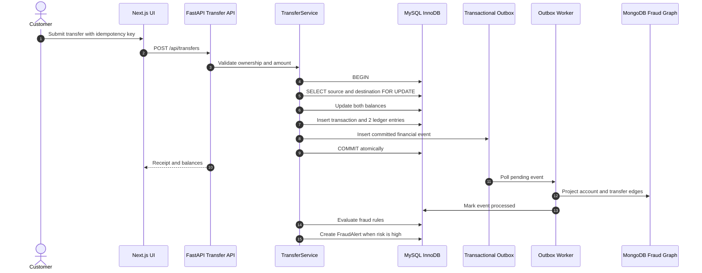
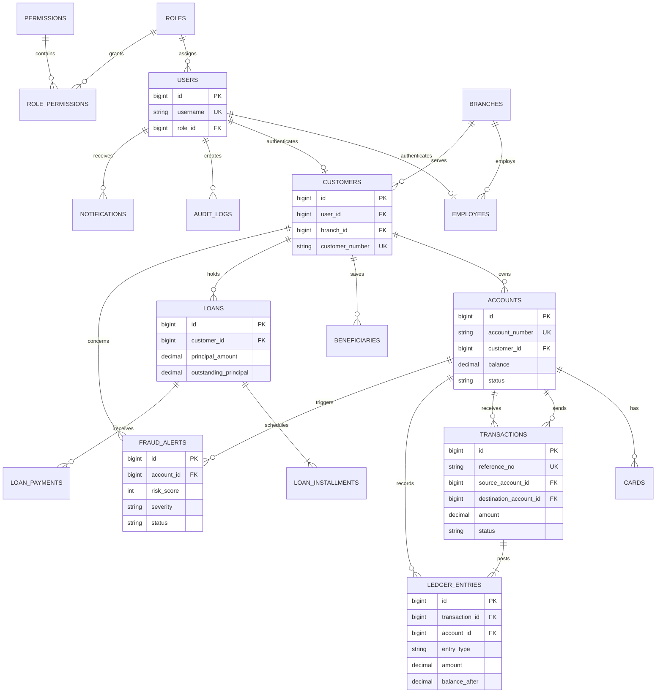

# Advanced Bank Management System - Project Report

## 1. Objective

ABMS is a demonstration banking platform for showing how a financial system
can combine transactional correctness, concurrency control, double-entry
bookkeeping, fraud analytics, caching, auditability, and role-based operations
in one application.

The project is intended for local development and DBMS demonstrations, not
production banking or real-money processing.

## 2. Features

### Customer

- Login with JWT authentication and role-based navigation.
- View savings/checking balances, cards, beneficiaries, and transaction history.
- Transfer funds with idempotency protection and atomic balance updates.
- Inspect debit/credit ledger entries for a transaction.
- Apply for loans, view amortization schedules, and pay installments.
- Lock and unlock debit cards.

### Employee and manager

- Customer onboarding and account provisioning.
- KYC review and account security actions.
- Loan review, approval, and disbursement workflows.
- Branch KPIs, deposits, loan portfolio, and high-value transaction surveillance.

### Administrator

- Audit-log browsing and SHA-256 chain verification.
- Concurrency and rollback fault-injection demonstrations.
- MySQL query-plan and index diagnostics.
- Fraud alert review and MongoDB fraud-graph exploration.
- Redis cache benchmark and service diagnostics.

### Seeded fraud demonstration

The demo seed includes `TXN-FRD-2026103`, a completed INR 120,000 transfer
from Vikram Singh's account (`1000202602`) to Ananya Sharma's account
(`1000202603`). It has matching debit/credit ledger entries and the critical
alert `ALT-2026-0101`, allowing the transaction history and fraud dashboard to
be demonstrated without creating a live transaction.

## 3. Architecture

### High-level system architecture

### Financial transaction and fraud flow

### Relational database structure

- **Frontend:** Next.js App Router, React, TypeScript, Tailwind CSS, Recharts,
  and Lucide icons.
- **API:** FastAPI routers, Pydantic schemas, SQLAlchemy services, JWT and
  Argon2id password verification.
- **Relational path:** MySQL stores users, accounts, balances, transactions,
  ledger entries, loans, audit logs, notifications, and outbox events.
- **Fraud path:** MySQL stores operational fraud alerts; MongoDB stores graph
  nodes and edges for relationship and cycle analysis.
- **Async path:** completed financial events are written to the transactional
  outbox and projected by a background worker.
- **Cache path:** Redis provides cache-aside acceleration, rate limiting, and
  diagnostics; development fallback is available when Redis is unavailable.

## 4. Database schema

### MySQL tables

| Area | Tables | Purpose |
|---|---|---|
| Access control | `roles`, `permissions`, `role_permissions`, `users` | Authentication and authorization |
| Organization | `branches`, `employees`, `customers` | Bank structure and customer/KYC data |
| Banking | `accounts`, `cards`, `beneficiaries` | Customer accounts and payment instruments |
| Payments | `transactions`, `ledger_entries` | Transfers and balanced double-entry postings |
| Lending | `loans`, `loan_installments`, `loan_payments` | Loans, EMI schedules, and repayments |
| Governance | `audit_logs`, `fraud_alerts`, `notifications` | Auditability, fraud operations, and user alerts |
| Integration | `outbox_events` | Reliable asynchronous event publication |

### MySQL views and programmable objects

- `v_account_summaries` hides system accounts from customer summaries.
- `v_branch_financial_kpis` aggregates branch deposits, customers, accounts,
  and loan exposure.
- `v_customer_loan_overview` combines loan and installment status.
- Stored procedures support reconciliation and diagnostics.
- Foreign keys, unique constraints, checks, and indexes protect invariants.

### MongoDB collections

- `fraud_graph_nodes`: accounts, customers, devices, IPs, and other entities.
- `fraud_graph_edges`: transfers, shared devices, shared IPs, and graph links.
- Audit/security projection collections support investigation workflows.

### Redis keys

Redis is not a relational schema. The application uses namespaced cache,
rate-limit, session, and benchmark keys with expiration where appropriate.

## 5. Advanced database features used

1. **ACID transactions:** transfer balance changes, transaction rows, and
   ledger entries commit or roll back together.
2. **Pessimistic locking:** `SELECT ... FOR UPDATE` locks both accounts in a
   stable order to prevent lost updates and negative balances.
3. **Double-entry accounting:** every completed transfer has one debit and one
   credit entry for the same amount.
4. **Idempotency:** repeated client requests with the same idempotency key do
   not create duplicate financial transfers.
5. **Transactional outbox:** integration events are committed with the
   financial transaction and processed asynchronously.
6. **Foreign keys and checks:** relationships and amount/balance/risk
   invariants are enforced by MySQL.
7. **Composite indexes:** account statements, outbox polling, audit queries,
   loan schedules, and transaction history are indexed for their access paths.
8. **SQL views and query plans:** reusable reporting views and `EXPLAIN`
   diagnostics expose database execution behavior.
9. **Hash-chained audit logs:** each audit record references the prior hash and
   carries its own SHA-256 record hash.
10. **MongoDB graph analytics:** fraud relationships and circular money-flow
    patterns are represented as nodes and edges.
11. **Redis cache-aside and rate limiting:** hot reads and request counters are
    kept outside the transactional source of truth.

## 6. File responsibilities

### Backend

| Path | Responsibility |
|---|---|
| `backend/app/main.py` | FastAPI application, startup checks, middleware, and router registration |
| `backend/app/core/` | Configuration, MySQL/MongoDB/Redis clients, auth, security, and rate limiting |
| `backend/app/models/` | SQLAlchemy entities and relationships |
| `backend/app/schemas/` | Pydantic request and response contracts |
| `backend/app/routers/` | HTTP endpoints for auth, accounts, transfers, loans, fraud, reports, and diagnostics |
| `backend/app/services/transfer_service.py` | Atomic transfer execution, locking, ledger, outbox, and audit work |
| `backend/app/services/fraud_detector.py` | Post-transfer fraud rules and alert creation |
| `backend/app/services/outbox_worker.py` | MongoDB projection of committed outbox events |
| `backend/app/services/scheduler.py` | Scheduled background jobs |
| `backend/tests/` | API, database, concurrency, fraud, seed, and worker tests |

### Frontend

| Path | Responsibility |
|---|---|
| `frontend/src/app/` | Route pages and role-specific layouts |
| `frontend/src/components/` | Shared navigation, cards, tables, transfers, analytics, and diagnostics UI |
| `frontend/src/components/diagnostics/` | Interactive DBMS demonstrations |
| `frontend/src/context/` | Authentication and toast state |
| `frontend/src/services/api.ts` | Typed API client, auth headers, session expiry, and error handling |
| `frontend/src/utils/display.ts` | Display formatting and data normalization |

### Database and documentation

| Path | Responsibility |
|---|---|
| `database/scripts/schema.sql` | MySQL tables, constraints, indexes, views, and procedures |
| `database/scripts/seed_10_records.sql` | Repeatable demo SQL snapshot |
| `database/seed_data/seed.py` | ORM-based seed generator/source |
| `database/migrations/` | Alembic migration history |
| `docs/demo_guide.md` | Presentation/demo walkthrough |
| `README.md` | Setup, credentials, services, and quick start |

## 7. Limitations and risks

- This is a local/demo system; it is not certified for regulated banking,
  payments, PCI DSS, or production financial use.
- The seed contains demo credentials and must never be reused in deployment.
- MySQL is the source of truth; MongoDB and Redis are derived/auxiliary
  services and require operational monitoring in real deployments.
- The application has no real payment-network integration, MFA, customer
  notification provider, or production key-management service.
- Fraud rules are deterministic demonstrations, not a trained production
  model and may produce false positives or false negatives.
- Local startup still requires MySQL and MongoDB; Redis can use the embedded
  development fallback.
- Seed SQL is intended for a clean/demo database. Back up live data before
  applying schema or seed changes.
- The frontend and backend need separate processes in local development.

## 8. Validation performed

- Frontend production build passes with Next.js TypeScript checking.
- Backend modules and schemas compile successfully.
- FastAPI health checks verified MySQL, MongoDB, and Docker Redis connectivity.
- Transaction history API returned `reference_no` values and two ledger entries.
- Seed data includes customer accounts, cards, transfers, loans, repayments,
  fraud alerts, notifications, audit records, and outbox events.
- The fraud demo transfer is balanced: one debit and one credit, both for
  INR 120,000, with the related critical alert.
- Existing automated backend tests cover API routes, seed counts, fraud rules,
  database behavior, concurrency, and outbox processing; run them against
  configured services before deployment.

## 9. Running the demonstration

1. Configure local MySQL in `.env`, start MongoDB, and start Redis in Docker.
2. Apply the schema and seed SQL on a demo database.
3. Start FastAPI on port 8000 and Next.js on port 3000.
4. Log in as `admin` to inspect fraud and diagnostics, or as a customer to
   view the seeded transfer and its ledger.
5. Open `/admin/fraud` and `/admin/fraud-graph` to inspect fraud evidence.
