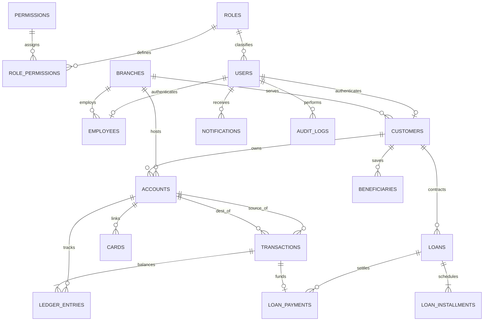

# Advanced Bank Management System (ABMS) - Relational Database Schema & 3NF Normalization Analysis

**System Version:** 2.6 Enterprise Banking Edition  
**Database Engine:** MySQL 8.0 InnoDB  
**Storage Engine Architecture:** Row-Level Locking (`SELECT ... FOR UPDATE`), Multi-Version Concurrency Control (MVCC), ACID Compliance, Foreign Key Cascade/Restrict Invariants, Cryptographic Hash Chaining.

---

## 1. Relational Database Overview & High-Level Architecture

The ABMS relational schema models a tier-1 core banking and enterprise ledger system. It enforces:
1. **Separation of Authentication & Identity:** Credentials and RBAC authentication are decoupled from bank employee and customer customer-relationship records.
2. **Double-Entry Bookkeeping:** Every monetary transaction produces balanced debit and credit ledger entries (`SUM(debit) == SUM(credit)`).
3. **Pessimistic Concurrency Guarantee:** Account locks are strictly ordered by ascending primary key (`MIN(id) -> MAX(id)`) to mathematically prevent deadlocks during concurrent multi-account settlements.
4. **Audit Immutability & Event Outbox:** Financial alterations emit chained cryptographic SHA-256 audit records and transactional outbox events to synchronize read models and MongoDB graph topologies.

---

## 2. Comprehensive Relational Schema Specification (All 19 Entities)

### 2.1 Table: `roles`
Stores access control roles within the system.

- **Columns:**
  - `id`: `BIGINT AUTO_INCREMENT` (PK, NOT NULL)
  - `name`: `VARCHAR(50)` (NOT NULL, UNIQUE) — System role key (e.g. `admin`, `customer`)
  - `display_name`: `VARCHAR(100)` (NOT NULL) — Human readable role title
  - `description`: `TEXT` (NULL)
  - `created_at`: `DATETIME` (DEFAULT `CURRENT_TIMESTAMP`)
- **Sample Data:**
  | id | name | display_name | description |
  |---|---|---|---|
  | 1 | admin | System Administrator | Full administrative and diagnostic control |
  | 2 | branch_manager | Branch Manager | Branch operations, approvals, and reports |
  | 3 | employee | Bank Employee | Customer servicing, KYC verification |
  | 4 | customer | Bank Customer | Personal retail banking portal user |

---

### 2.2 Table: `permissions`
Granular privileges that can be mapped to roles.

- **Columns:**
  - `id`: `BIGINT AUTO_INCREMENT` (PK, NOT NULL)
  - `code`: `VARCHAR(100)` (NOT NULL, UNIQUE) — Permission code identifier
  - `name`: `VARCHAR(100)` (NOT NULL)
  - `category`: `VARCHAR(50)` (NOT NULL)
  - `description`: `TEXT` (NULL)
  - `created_at`: `DATETIME` (DEFAULT `CURRENT_TIMESTAMP`)
- **Sample Data:**
  | id | code | name | category |
  |---|---|---|---|
  | 1 | account:create | Create Bank Account | Account Management |
  | 9 | tx:transfer | Transfer Funds | Financial Transactions |
  | 13 | loan:apply | Apply for Loan | Loan Services |
  | 19 | system:diagnostics | Access DBMS Diagnostics | System Administration |

---

### 2.3 Table: `role_permissions`
Join table establishing Many-to-Many association between `roles` and `permissions`.

- **Columns:**
  - `role_id`: `BIGINT` (PK, FK -> `roles.id` ON DELETE CASCADE)
  - `permission_id`: `BIGINT` (PK, FK -> `permissions.id` ON DELETE CASCADE)
- **Constraints:** Composite Primary Key `(role_id, permission_id)`
- **Sample Data:**
  | role_id | permission_id |
  |---|---|
  | 1 (admin) | 1 (account:create) |
  | 1 (admin) | 9 (tx:transfer) |
  | 4 (customer) | 9 (tx:transfer) |
  | 4 (customer) | 13 (loan:apply) |

---

### 2.4 Table: `users`
Authentication credentials, security status, and account locking metadata.

- **Columns:**
  - `id`: `BIGINT AUTO_INCREMENT` (PK, NOT NULL)
  - `username`: `VARCHAR(50)` (NOT NULL, UNIQUE)
  - `email`: `VARCHAR(120)` (NOT NULL, UNIQUE)
  - `password_hash`: `VARCHAR(255)` (NOT NULL) — Argon2id / bcrypt salted hash
  - `role_id`: `BIGINT` (NOT NULL, FK -> `roles.id`)
  - `is_active`: `BOOLEAN` (NOT NULL, DEFAULT `TRUE`)
  - `is_locked`: `BOOLEAN` (NOT NULL, DEFAULT `FALSE`)
  - `failed_login_attempts`: `INT` (NOT NULL, DEFAULT `0`)
  - `last_login`: `DATETIME` (NULL)
  - `created_at`: `DATETIME` (NOT NULL, DEFAULT `CURRENT_TIMESTAMP`)
  - `updated_at`: `DATETIME` (NOT NULL, DEFAULT `CURRENT_TIMESTAMP ON UPDATE CURRENT_TIMESTAMP`)
- **Indexes:**
  - `UNIQUE (username)`
  - `UNIQUE (email)`
  - `fk_users_role (role_id)`
- **Sample Data:**
  | id | username | email | role_id | is_active | is_locked |
  |---|---|---|---|---|---|
  | 1 | admin | admin@abmsbank.com | 1 | 1 | 0 |
  | 2 | manager_delhi | manager.delhi@abmsbank.com | 2 | 1 | 0 |
  | 3 | officer_delhi | officer.delhi@abmsbank.com | 3 | 1 | 0 |
  | 5 | alex_turner | alex.turner@gmail.com | 4 | 1 | 0 |

---

### 2.5 Table: `branches`
Physical branches managing local customer accounts and financial operations.

- **Columns:**
  - `id`: `BIGINT AUTO_INCREMENT` (PK, NOT NULL)
  - `branch_code`: `VARCHAR(20)` (NOT NULL, UNIQUE)
  - `name`: `VARCHAR(100)` (NOT NULL)
  - `ifsc_code`: `VARCHAR(20)` (NOT NULL, UNIQUE)
  - `address`: `TEXT` (NOT NULL)
  - `city`: `VARCHAR(60)` (NOT NULL)
  - `state`: `VARCHAR(60)` (NOT NULL)
  - `postal_code`: `VARCHAR(20)` (NOT NULL)
  - `phone`: `VARCHAR(20)` (NOT NULL)
  - `email`: `VARCHAR(100)` (NOT NULL)
  - `is_active`: `BOOLEAN` (NOT NULL, DEFAULT `TRUE`)
  - `created_at`: `DATETIME` (NOT NULL, DEFAULT `CURRENT_TIMESTAMP`)
- **Indexes:**
  - `UNIQUE (branch_code)`
  - `UNIQUE (ifsc_code)`
- **Sample Data:**
  | id | branch_code | name | ifsc_code | city | state |
  |---|---|---|---|---|---|
  | 1 | BR001 | Delhi Connaught Place | ABMS0000001 | New Delhi | Delhi |
  | 2 | BR002 | Mumbai Nariman Point | ABMS0000002 | Mumbai | Maharashtra |
  | 3 | BR003 | Bangalore Indiranagar | ABMS0000003 | Bangalore | Karnataka |

---

### 2.6 Table: `employees`
Internal staff profiles linked to authentication users and branches.

- **Columns:**
  - `id`: `BIGINT AUTO_INCREMENT` (PK, NOT NULL)
  - `user_id`: `BIGINT` (NOT NULL, UNIQUE, FK -> `users.id` ON DELETE CASCADE)
  - `branch_id`: `BIGINT` (NOT NULL, FK -> `branches.id`)
  - `employee_code`: `VARCHAR(30)` (NOT NULL, UNIQUE)
  - `first_name`: `VARCHAR(60)` (NOT NULL)
  - `last_name`: `VARCHAR(60)` (NOT NULL)
  - `designation`: `VARCHAR(60)` (NOT NULL)
  - `department`: `VARCHAR(60)` (NOT NULL)
  - `phone`: `VARCHAR(20)` (NOT NULL)
  - `hire_date`: `DATE` (NOT NULL)
  - `is_active`: `BOOLEAN` (NOT NULL, DEFAULT `TRUE`)
  - `created_at`: `DATETIME` (NOT NULL, DEFAULT `CURRENT_TIMESTAMP`)
- **Sample Data:**
  | id | user_id | branch_id | employee_code | first_name | last_name | designation |
  |---|---|---|---|---|---|---|
  | 1 | 2 | 1 | EMP001 | Rajesh | Sharma | Branch Manager |
  | 2 | 3 | 1 | EMP002 | Sunita | Verma | Senior Officer |
  | 3 | 4 | 2 | EMP003 | Amit | Patel | Branch Manager |

---

### 2.7 Table: `customers`
Customer relationship records including identity, contact details, and KYC status.

- **Columns:**
  - `id`: `BIGINT AUTO_INCREMENT` (PK, NOT NULL)
  - `user_id`: `BIGINT` (NOT NULL, UNIQUE, FK -> `users.id` ON DELETE CASCADE)
  - `branch_id`: `BIGINT` (NOT NULL, FK -> `branches.id`)
  - `customer_number`: `VARCHAR(30)` (NOT NULL, UNIQUE)
  - `first_name`: `VARCHAR(60)` (NOT NULL)
  - `last_name`: `VARCHAR(60)` (NOT NULL)
  - `date_of_birth`: `DATE` (NOT NULL)
  - `gender`: `VARCHAR(10)` (NOT NULL)
  - `phone`: `VARCHAR(20)` (NOT NULL, UNIQUE)
  - `email`: `VARCHAR(120)` (NOT NULL, UNIQUE)
  - `address`: `TEXT` (NOT NULL)
  - `city`: `VARCHAR(60)` (NOT NULL)
  - `state`: `VARCHAR(60)` (NOT NULL)
  - `postal_code`: `VARCHAR(20)` (NOT NULL)
  - `pan_number`: `VARCHAR(20)` (NOT NULL, UNIQUE)
  - `kyc_status`: `ENUM('PENDING', 'VERIFIED', 'REJECTED')` (NOT NULL, DEFAULT `'PENDING'`)
  - `kyc_document_type`: `VARCHAR(50)` (NOT NULL)
  - `kyc_document_id`: `VARCHAR(50)` (NOT NULL)
  - `verified_by_employee_id`: `BIGINT` (NULL, FK -> `employees.id`)
  - `verified_at`: `DATETIME` (NULL)
  - `created_at`: `DATETIME` (NOT NULL, DEFAULT `CURRENT_TIMESTAMP`)
  - `updated_at`: `DATETIME` (NOT NULL, DEFAULT `CURRENT_TIMESTAMP ON UPDATE CURRENT_TIMESTAMP`)
- **Sample Data:**
  | id | user_id | branch_id | customer_number | first_name | last_name | pan_number | kyc_status |
  |---|---|---|---|---|---|---|---|
  | 1 | 5 | 1 | CUST000001 | Alex | Turner | ABCDE1234F | VERIFIED |
  | 2 | 6 | 1 | CUST000002 | Sarah | Connor | BCDEF2345G | VERIFIED |
  | 3 | 7 | 2 | CUST000003 | Vikram | Singh | CDEFG3456H | VERIFIED |

---

### 2.8 Table: `accounts`
Deposit and settlement bank accounts.

- **Columns:**
  - `id`: `BIGINT AUTO_INCREMENT` (PK, NOT NULL)
  - `account_number`: `VARCHAR(30)` (NOT NULL, UNIQUE)
  - `customer_id`: `BIGINT` (NULL, FK -> `customers.id` ON DELETE RESTRICT)
  - `branch_id`: `BIGINT` (NULL, FK -> `branches.id` ON DELETE RESTRICT)
  - `account_type`: `ENUM('SAVINGS', 'CHECKING', 'SYSTEM_CLEARING', 'LOAN_SETTLEMENT')` (NOT NULL)
  - `balance`: `DECIMAL(18, 4)` (NOT NULL, DEFAULT `0.0000`)
  - `currency`: `VARCHAR(3)` (NOT NULL, DEFAULT `'INR'`)
  - `status`: `ENUM('ACTIVE', 'FROZEN', 'DORMANT', 'CLOSED')` (NOT NULL, DEFAULT `'ACTIVE'`)
  - `is_system_account`: `BOOLEAN` (NOT NULL, DEFAULT `FALSE`)
  - `version`: `BIGINT` (NOT NULL, DEFAULT `1`) — Optimistic locking token
  - `created_at`: `DATETIME` (NOT NULL, DEFAULT `CURRENT_TIMESTAMP`)
  - `updated_at`: `DATETIME` (NOT NULL, DEFAULT `CURRENT_TIMESTAMP ON UPDATE CURRENT_TIMESTAMP`)
- **Check Constraints:**
  - `chk_acc_balance`: `CHECK (balance >= 0.0000 OR is_system_account = TRUE)`
- **Indexes:**
  - `idx_accounts_customer (customer_id)`
  - `idx_accounts_branch_type (branch_id, account_type)`
  - `idx_accounts_status (status)`
- **Sample Data:**
  | id | account_number | customer_id | branch_id | account_type | balance | status | is_system |
  |---|---|---|---|---|---|---|---|
  | 1 | 1000202600 | 1 | 1 | SAVINGS | 5000.0000 | ACTIVE | 0 |
  | 2 | 1000202601 | 2 | 1 | SAVINGS | 125000.0000 | ACTIVE | 0 |
  | 17 | SYS_CLEARING_01 | NULL | 1 | SYSTEM_CLEARING | 0.0000 | ACTIVE | 1 |
  | 18 | SYS_LOAN_SETTLE | NULL | 1 | LOAN_SETTLEMENT | 0.0000 | ACTIVE | 1 |

---

### 2.9 Table: `cards`
Debit and credit payment cards issued for accounts.

- **Columns:**
  - `id`: `BIGINT AUTO_INCREMENT` (PK, NOT NULL)
  - `account_id`: `BIGINT` (NOT NULL, FK -> `accounts.id` ON DELETE CASCADE)
  - `card_number_masked`: `VARCHAR(20)` (NOT NULL)
  - `card_number_hash`: `VARCHAR(64)` (NOT NULL, UNIQUE) — SHA-256 token
  - `card_type`: `ENUM('DEBIT', 'CREDIT')` (NOT NULL)
  - `expiry_month`: `INT` (NOT NULL)
  - `expiry_year`: `INT` (NOT NULL)
  - `daily_atm_limit`: `DECIMAL(15, 2)` (NOT NULL, DEFAULT `50000.00`)
  - `daily_pos_limit`: `DECIMAL(15, 2)` (NOT NULL, DEFAULT `100000.00`)
  - `is_blocked`: `BOOLEAN` (NOT NULL, DEFAULT `FALSE`)
  - `block_reason`: `VARCHAR(255)` (NULL)
  - `created_at`: `DATETIME` (NOT NULL, DEFAULT `CURRENT_TIMESTAMP`)
- **Check Constraints:**
  - `chk_card_exp_month`: `CHECK (expiry_month BETWEEN 1 AND 12)`
  - `chk_card_exp_year`: `CHECK (expiry_year >= 2026)`
- **Sample Data:**
  | id | account_id | card_number_masked | card_type | expiry_month | expiry_year | is_blocked |
  |---|---|---|---|---|---|---|
  | 1 | 1 | 4532 **** **** 1001 | DEBIT | 12 | 2028 | 0 |
  | 2 | 2 | 4532 **** **** 1002 | DEBIT | 6 | 2029 | 0 |

---

### 2.10 Table: `beneficiaries`
Whitelisted payees saved by customers for fund transfers.

- **Columns:**
  - `id`: `BIGINT AUTO_INCREMENT` (PK, NOT NULL)
  - `customer_id`: `BIGINT` (NOT NULL, FK -> `customers.id` ON DELETE CASCADE)
  - `beneficiary_name`: `VARCHAR(100)` (NOT NULL)
  - `account_number`: `VARCHAR(30)` (NOT NULL)
  - `ifsc_code`: `VARCHAR(20)` (NOT NULL)
  - `bank_name`: `VARCHAR(100)` (NOT NULL)
  - `daily_limit`: `DECIMAL(15, 2)` (NOT NULL, DEFAULT `200000.00`)
  - `is_verified`: `BOOLEAN` (NOT NULL, DEFAULT `TRUE`)
  - `created_at`: `DATETIME` (NOT NULL, DEFAULT `CURRENT_TIMESTAMP`)
- **Constraints:**
  - `UNIQUE uq_cust_ben_account (customer_id, account_number)`
- **Sample Data:**
  | id | customer_id | beneficiary_name | account_number | ifsc_code | bank_name |
  |---|---|---|---|---|---|
  | 1 | 1 | Sarah Connor | 1000202601 | ABMS0000001 | ABMS Downtown |
  | 2 | 1 | Vikram Singh | 1000202602 | ABMS0000002 | ABMS Tech Corridor |

---

### 2.11 Table: `transactions`
Business financial transaction header with idempotency keys and state tracking.

- **Columns:**
  - `id`: `BIGINT AUTO_INCREMENT` (PK, NOT NULL)
  - `reference_no`: `VARCHAR(40)` (NOT NULL, UNIQUE)
  - `idempotency_key`: `VARCHAR(64)` (NULL, UNIQUE)
  - `source_account_id`: `BIGINT` (NOT NULL, FK -> `accounts.id`)
  - `destination_account_id`: `BIGINT` (NOT NULL, FK -> `accounts.id`)
  - `amount`: `DECIMAL(18, 4)` (NOT NULL)
  - `currency`: `VARCHAR(3)` (NOT NULL, DEFAULT `'INR'`)
  - `transaction_type`: `ENUM('TRANSFER', 'DEPOSIT', 'WITHDRAWAL', 'LOAN_DISBURSEMENT', 'LOAN_REPAYMENT', 'INTEREST_CREDIT')` (NOT NULL)
  - `status`: `ENUM('PENDING', 'COMPLETED', 'FAILED', 'ROLLED_BACK')` (NOT NULL, DEFAULT `'PENDING'`)
  - `description`: `VARCHAR(255)` (NOT NULL)
  - `created_at`: `DATETIME` (NOT NULL, DEFAULT `CURRENT_TIMESTAMP`)
  - `completed_at`: `DATETIME` (NULL)
- **Check Constraints:**
  - `chk_tx_amount`: `CHECK (amount > 0.0000)`
- **Indexes:**
  - `idx_tx_src_created (source_account_id, created_at DESC)`
  - `idx_tx_dst_created (destination_account_id, created_at DESC)`
  - `idx_tx_status_type (status, transaction_type)`
  - `idx_tx_created (created_at)`
- **Sample Data:**
  | id | reference_no | source_id | dest_id | amount | transaction_type | status |
  |---|---|---|---|---|---|---|
  | 1 | TXN202610310001 | 17 | 1 | 50000.0000 | DEPOSIT | COMPLETED |
  | 2 | TXN202610310002 | 17 | 2 | 125000.0000 | DEPOSIT | COMPLETED |
  | 11 | TXN202610310011 | 1 | 2 | 1500.0000 | TRANSFER | COMPLETED |

---

### 2.12 Table: `ledger_entries`
Immutable double-entry general ledger. Every transaction writes 2 rows (DEBIT and CREDIT).

- **Columns:**
  - `id`: `BIGINT AUTO_INCREMENT` (PK, NOT NULL)
  - `transaction_id`: `BIGINT` (NOT NULL, FK -> `transactions.id` ON DELETE CASCADE)
  - `account_id`: `BIGINT` (NOT NULL, FK -> `accounts.id`)
  - `entry_type`: `ENUM('DEBIT', 'CREDIT')` (NOT NULL)
  - `amount`: `DECIMAL(18, 4)` (NOT NULL)
  - `balance_after`: `DECIMAL(18, 4)` (NOT NULL) — Snapshot of balance post-entry
  - `posted_at`: `DATETIME` (NOT NULL, DEFAULT `CURRENT_TIMESTAMP`)
- **Check Constraints:**
  - `chk_le_amount`: `CHECK (amount > 0.0000)`
- **Indexes:**
  - `idx_le_acc_posted (account_id, posted_at DESC)`
  - `idx_le_tx_entry (transaction_id, entry_type)`
- **Sample Data:**
  | id | transaction_id | account_id | entry_type | amount | balance_after |
  |---|---|---|---|---|---|
  | 1 | 1 | 17 | DEBIT | 50000.0000 | -50000.0000 |
  | 2 | 1 | 1 | CREDIT | 50000.0000 | 50000.0000 |
  | 21 | 11 | 1 | DEBIT | 1500.0000 | 5000.0000 |
  | 22 | 11 | 2 | CREDIT | 1500.0000 | 125000.0000 |

---

### 2.13 Table: `loans`
Customer loan agreements and amortization terms.

- **Columns:**
  - `id`: `BIGINT AUTO_INCREMENT` (PK, NOT NULL)
  - `loan_number`: `VARCHAR(30)` (NOT NULL, UNIQUE)
  - `customer_id`: `BIGINT` (NOT NULL, FK -> `customers.id`)
  - `branch_id`: `BIGINT` (NOT NULL, FK -> `branches.id`)
  - `disbursement_account_id`: `BIGINT` (NOT NULL, FK -> `accounts.id`)
  - `loan_type`: `ENUM('PERSONAL', 'HOME', 'AUTO', 'BUSINESS')` (NOT NULL)
  - `principal_amount`: `DECIMAL(18, 4)` (NOT NULL)
  - `annual_interest_rate`: `DECIMAL(5, 2)` (NOT NULL)
  - `tenure_months`: `INT` (NOT NULL)
  - `monthly_emi`: `DECIMAL(18, 4)` (NOT NULL)
  - `outstanding_principal`: `DECIMAL(18, 4)` (NOT NULL)
  - `outstanding_interest`: `DECIMAL(18, 4)` (NOT NULL)
  - `status`: `ENUM('APPLIED', 'APPROVED', 'DISBURSED', 'CLOSED', 'REJECTED')` (NOT NULL, DEFAULT `'APPLIED'`)
  - `applied_at`: `DATETIME` (NOT NULL, DEFAULT `CURRENT_TIMESTAMP`)
  - `approved_at`: `DATETIME` (NULL)
  - `disbursed_at`: `DATETIME` (NULL)
  - `approved_by_employee_id`: `BIGINT` (NULL, FK -> `employees.id`)
- **Check Constraints:**
  - `chk_loan_principal`: `CHECK (principal_amount > 0.0000)`
  - `chk_loan_rate`: `CHECK (annual_interest_rate >= 0.00 AND annual_interest_rate <= 100.00)`
  - `chk_loan_tenure`: `CHECK (tenure_months > 0)`
- **Indexes:**
  - `idx_loans_customer (customer_id, status)`
  - `idx_loans_branch (branch_id, status)`
- **Sample Data:**
  | id | loan_number | customer_id | loan_type | principal | interest_rate | tenure | emi | status |
  |---|---|---|---|---|---|---|---|---|
  | 1 | LN20261001 | 1 | PERSONAL | 200000.0000 | 10.50 | 12 | 17629.0000 | DISBURSED |
  | 2 | LN20261002 | 2 | HOME | 3500000.0000 | 8.25 | 12 | 304890.0000 | DISBURSED |

---

### 2.14 Table: `loan_installments`
Detailed installment amortization breakdown for scheduled repayments.

- **Columns:**
  - `id`: `BIGINT AUTO_INCREMENT` (PK, NOT NULL)
  - `loan_id`: `BIGINT` (NOT NULL, FK -> `loans.id` ON DELETE CASCADE)
  - `installment_number`: `INT` (NOT NULL)
  - `due_date`: `DATE` (NOT NULL)
  - `principal_component`: `DECIMAL(18, 4)` (NOT NULL)
  - `interest_component`: `DECIMAL(18, 4)` (NOT NULL)
  - `total_amount`: `DECIMAL(18, 4)` (NOT NULL)
  - `status`: `ENUM('PENDING', 'PAID', 'OVERDUE')` (NOT NULL, DEFAULT `'PENDING'`)
  - `paid_at`: `DATETIME` (NULL)
- **Constraints:**
  - `UNIQUE uq_loan_installment (loan_id, installment_number)`
- **Indexes:**
  - `idx_li_loan_due (loan_id, due_date, status)`
  - `idx_li_status_due (status, due_date)`
- **Sample Data:**
  | id | loan_id | installment_no | due_date | principal | interest | total | status |
  |---|---|---|---|---|---|---|---|
  | 1 | 1 | 1 | 2026-11-30 | 15879.0000 | 1750.0000 | 17629.0000 | PAID |
  | 2 | 1 | 2 | 2026-12-30 | 16018.0000 | 1611.0000 | 17629.0000 | PENDING |

---

### 2.15 Table: `loan_payments`
Audit records linking financial transactions to loan repayment settlements.

- **Columns:**
  - `id`: `BIGINT AUTO_INCREMENT` (PK, NOT NULL)
  - `loan_id`: `BIGINT` (NOT NULL, FK -> `loans.id`)
  - `installment_id`: `BIGINT` (NULL, FK -> `loan_installments.id`)
  - `transaction_id`: `BIGINT` (NOT NULL, FK -> `transactions.id`)
  - `amount_paid`: `DECIMAL(18, 4)` (NOT NULL)
  - `principal_paid`: `DECIMAL(18, 4)` (NOT NULL)
  - `interest_paid`: `DECIMAL(18, 4)` (NOT NULL)
  - `payment_date`: `DATETIME` (NOT NULL, DEFAULT `CURRENT_TIMESTAMP`)
- **Check Constraints:**
  - `chk_lp_amount`: `CHECK (amount_paid > 0.0000)`
- **Sample Data:**
  | id | loan_id | installment_id | transaction_id | amount_paid | principal_paid | interest_paid |
  |---|---|---|---|---|---|---|
  | 1 | 1 | 1 | 1 | 17629.0000 | 15879.0000 | 1750.0000 |
  | 2 | 2 | 13 | 2 | 304890.0000 | 280852.0000 | 24038.0000 |

---

### 2.16 Table: `audit_logs`
Cryptographically chained audit trail (`prev_hash` -> `record_hash`).

- **Columns:**
  - `id`: `BIGINT AUTO_INCREMENT` (PK, NOT NULL)
  - `user_id`: `BIGINT` (NULL, FK -> `users.id` ON DELETE SET NULL)
  - `actor_role`: `VARCHAR(50)` (NOT NULL)
  - `action`: `VARCHAR(100)` (NOT NULL)
  - `entity_type`: `VARCHAR(60)` (NOT NULL)
  - `entity_id`: `VARCHAR(60)` (NOT NULL)
  - `old_values`: `JSON` (NULL)
  - `new_values`: `JSON` (NULL)
  - `ip_address`: `VARCHAR(45)` (NOT NULL, DEFAULT `'127.0.0.1'`)
  - `user_agent`: `VARCHAR(255)` (NULL)
  - `prev_hash`: `VARCHAR(64)` (NOT NULL)
  - `record_hash`: `VARCHAR(64)` (NOT NULL)
  - `created_at`: `DATETIME` (NOT NULL, DEFAULT `CURRENT_TIMESTAMP`)
- **Indexes:**
  - `idx_audit_entity (entity_type, entity_id, created_at DESC)`
  - `idx_audit_user_action (user_id, action, created_at DESC)`
- **Sample Data:**
  | id | actor_role | action | entity_type | entity_id | prev_hash | record_hash |
  |---|---|---|---|---|---|---|
  | 1 | SYSTEM | INITIALIZE_GENESIS | SYSTEM | 0 | 000000000000... | 4a7d... |
  | 2 | ADMIN | CREATE_USER | USER | 1 | 4a7d... | 8b3c... |

---

### 2.17 Table: `outbox_events`
Transactional outbox pattern table ensuring reliable dual-write synchronization from MySQL to MongoDB.

- **Columns:**
  - `id`: `BIGINT AUTO_INCREMENT` (PK, NOT NULL)
  - `event_id`: `VARCHAR(64)` (NOT NULL, UNIQUE)
  - `event_type`: `VARCHAR(100)` (NOT NULL)
  - `aggregate_type`: `VARCHAR(60)` (NOT NULL)
  - `aggregate_id`: `VARCHAR(60)` (NOT NULL)
  - `payload`: `JSON` (NOT NULL)
  - `status`: `ENUM('PENDING', 'PROCESSED', 'FAILED')` (NOT NULL, DEFAULT `'PENDING'`)
  - `retry_count`: `INT` (NOT NULL, DEFAULT `0`)
  - `created_at`: `DATETIME` (NOT NULL, DEFAULT `CURRENT_TIMESTAMP`)
  - `processed_at`: `DATETIME` (NULL)
- **Indexes:**
  - `idx_outbox_status_created (status, created_at ASC)`
- **Sample Data:**
  | id | event_id | event_type | aggregate_id | status | retry_count |
  |---|---|---|---|---|---|
  | 1 | EVT_TXN_001 | TRANSACTION_COMPLETED | TXN202610310001 | PROCESSED | 0 |
  | 2 | EVT_TXN_002 | TRANSACTION_COMPLETED | TXN202610310002 | PROCESSED | 0 |

---

### 2.18 Table: `fraud_alerts`
Relational mirror of suspicious activity flags and compliance investigations.

- **Columns:**
  - `id`: `BIGINT AUTO_INCREMENT` (PK, NOT NULL)
  - `alert_code`: `VARCHAR(40)` (NOT NULL, UNIQUE)
  - `account_id`: `BIGINT` (NULL, FK -> `accounts.id` ON DELETE SET NULL)
  - `customer_id`: `BIGINT` (NULL, FK -> `customers.id` ON DELETE SET NULL)
  - `risk_score`: `INT` (NOT NULL)
  - `severity`: `ENUM('LOW', 'MEDIUM', 'HIGH', 'CRITICAL')` (NOT NULL)
  - `alert_type`: `VARCHAR(100)` (NOT NULL)
  - `description`: `TEXT` (NOT NULL)
  - `status`: `ENUM('NEW', 'UNDER_INVESTIGATION', 'RESOLVED', 'FALSE_POSITIVE')` (NOT NULL, DEFAULT `'NEW'`)
  - `investigated_by_employee_id`: `BIGINT` (NULL, FK -> `employees.id`)
  - `investigation_notes`: `TEXT` (NULL)
  - `created_at`: `DATETIME` (NOT NULL, DEFAULT `CURRENT_TIMESTAMP`)
  - `updated_at`: `DATETIME` (NOT NULL, DEFAULT `CURRENT_TIMESTAMP ON UPDATE CURRENT_TIMESTAMP`)
- **Check Constraints:**
  - `chk_fa_score`: `CHECK (risk_score BETWEEN 0 AND 100)`
- **Sample Data:**
  | id | alert_code | customer_id | risk_score | severity | alert_type | status |
  |---|---|---|---|---|---|---|
  | 1 | FA20261001 | 1 | 85 | HIGH | RAPID_SUCCESSIVE_TRANSFERS | NEW |
  | 2 | FA20261002 | 2 | 92 | CRITICAL | CIRCULAR_TRANSFER_RING | UNDER_INVESTIGATION |

---

### 2.19 Table: `notifications`
Customer and staff notifications dispatched for banking events.

- **Columns:**
  - `id`: `BIGINT AUTO_INCREMENT` (PK, NOT NULL)
  - `user_id`: `BIGINT` (NOT NULL, FK -> `users.id` ON DELETE CASCADE)
  - `title`: `VARCHAR(150)` (NOT NULL)
  - `message`: `TEXT` (NOT NULL)
  - `type`: `ENUM('TRANSFER_RECEIVED', 'TRANSFER_SENT', 'LOAN_APPROVED', 'LOAN_DISBURSED', 'FRAUD_ALERT', 'SYSTEM')` (NOT NULL, DEFAULT `'SYSTEM'`)
  - `is_read`: `BOOLEAN` (NOT NULL, DEFAULT `FALSE`)
  - `link`: `VARCHAR(255)` (NULL)
  - `created_at`: `DATETIME` (NOT NULL, DEFAULT `CURRENT_TIMESTAMP`)
- **Indexes:**
  - `idx_notif_user_created (user_id, created_at DESC)`
  - `idx_notif_user_unread (user_id, is_read)`
- **Sample Data:**
  | id | user_id | title | type | is_read | link |
  |---|---|---|---|---|---|
  | 1 | 5 | Transfer Sent | TRANSFER_SENT | 0 | /customer/transactions |
  | 2 | 6 | Funds Received | TRANSFER_RECEIVED | 0 | /customer/transactions |

---

## 3. Formal 3NF Normalization Proof & Justification

A relational schema is in **Third Normal Form (3NF)** if and only if it satisfies **Second Normal Form (2NF)** and for every functional dependency \( X \rightarrow A \) where \( A \) is not a subset of \( X \):
1. \( X \) is a superkey of the relation, **OR**
2. \( A \) is a prime attribute (i.e. part of a candidate key).

We demonstrate the step-by-step progression from Unnormalized Form (UNF) through First (1NF), Second (2NF), and Third Normal Form (3NF).

### 3.1 First Normal Form (1NF) Compliance
- **Requirement:** Atomic attributes (no repeating groups, no comma-separated values, no composite attributes).
- **Enforcement in ABMS:**
  - Composite names are decomposed into `first_name` and `last_name`.
  - Postal addresses are decomposed into `address`, `city`, `state`, and `postal_code`.
  - Roles, permissions, cards, and beneficiaries are separated into distinct tables rather than array or JSON structures stored within customer or account records.
  - Multi-valued contact numbers are modeled as singular atomic columns with unique constraints.

### 3.2 Second Normal Form (2NF) Compliance
- **Requirement:** 1NF is satisfied, and no non-prime attribute is functionally dependent on a proper subset of any candidate key (no partial dependencies).
- **Enforcement in ABMS:**
  - Most tables employ surrogate primary keys (`id BIGINT AUTO_INCREMENT`), making every candidate key single-attribute. In a relation with a single-attribute candidate key, partial key dependencies are mathematically impossible.
  - In composite key tables such as `role_permissions (role_id, permission_id)`:
    - There are no non-prime attributes; all columns form the composite candidate key.
  - In `loan_installments (loan_id, installment_number)`:
    - Every non-prime attribute (`due_date`, `principal_component`, `interest_component`, `total_amount`, `status`) depends on both the specific `loan_id` AND the `installment_number`. Knowing only `loan_id` does not determine which installment date or principal applies. Hence, zero partial dependency exists.

### 3.3 Third Normal Form (3NF) Compliance (Elimination of Transitive Dependencies)
- **Requirement:** 2NF is satisfied, and no non-prime attribute is transitively dependent on the primary key (if \( X \rightarrow Y \) and \( Y \rightarrow Z \), then \( Y \) must be a superkey or \( Z \) must be prime).

#### Case 1: `users` vs `customers` vs `employees`
- *Anti-pattern in 2NF:* Storing employee job titles or customer PAN numbers directly inside `users`.
- *Transitive Dependency:* `users.id` \(\rightarrow\) `customer_number` \(\rightarrow\) `pan_number`, `kyc_status`.
- *Resolution in ABMS:* Authentication and identity credentials reside in `users` (`id`, `username`, `password_hash`, `role_id`). Customer-specific demographic attributes reside in `customers` with a 1-to-1 foreign key `user_id`. Employee organizational data resides in `employees`.

#### Case 2: `accounts` vs `branches`
- *Anti-pattern in 2NF:* Storing branch address, city, and branch manager inside `accounts`.
- *Transitive Dependency:* `accounts.id` \(\rightarrow\) `branch_id` \(\rightarrow\) `branch_name`, `city`, `ifsc_code`.
- *Resolution in ABMS:* Only the foreign key `branch_id` is maintained in `accounts`. Branch metadata resides exclusively in `branches`, eliminating update anomalies when a branch relocates.

#### Case 3: `transactions` vs `ledger_entries`
- *Anti-pattern in 2NF:* Attempting to record both debit and credit balance outcomes directly in the single `transactions` row.
- *Resolution in ABMS:* Transactions represent high-level business intents (`transactions`), whereas double-entry bookkeeping breaks the settlement into discrete atomic `ledger_entries` each scoped to exactly one account.

#### Case 4: `loans`, `loan_installments`, and `loan_payments`
- *Transitive Dependency Avoided:* Loan payments are decoupled from installments. A payment references `loan_id`, optionally `installment_id`, and `transaction_id`. Outstanding principal and interest are derived from financial entries rather than hardcoded calculated columns.

---

## 4. Constraint Matrix & Invariants

| Invariant Name | Scope | Enforcement Mechanism | Failure Response |
|---|---|---|---|
| Non-Negative Balance | `accounts.balance` | `CHECK (balance >= 0 OR is_system_account = 1)` | MySQL Error 3819 (Check constraint violated) |
| Double-Entry Parity | Financial Transfers | Application Transaction with dual `ledger_entries` | Atomically rolled back if `SUM(debit) != SUM(credit)` |
| Row Lock Hierarchy | Concurrency Engine | Ordered `SELECT ... FOR UPDATE` (`MIN(id) -> MAX(id)`) | Prevents deadlocks (Graph DAG acyclic) |
| Idempotency Protection | `transactions` | `UNIQUE (idempotency_key)` | HTTP 409 Conflict / HTTP 200 Cached Result |
| Audit Trail Integrity | `audit_logs` | Cryptographic SHA-256 chain (`prev_hash`) | Verification script flags tampering instantly |
| Amortization Invariant | `loan_installments` | `UNIQUE (loan_id, installment_number)` | Prevents duplicate schedule generation |
| Valid Expiry Date | `cards` | `CHECK (expiry_month BETWEEN 1 AND 12 AND expiry_year >= 2026)` | Rejects invalid cards at schema level |
